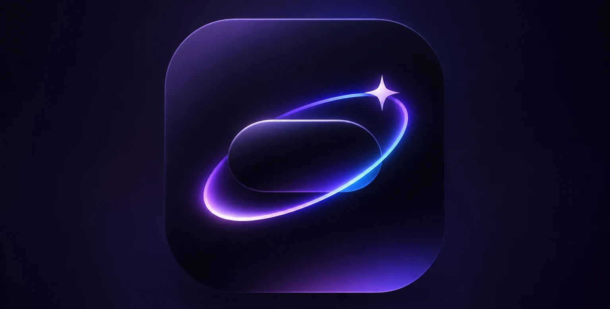

# Orbit

### La Dynamic Island per Windows

Una pillola elegante in cima allo schermo che mostra **musica, notifiche, timer, volume, luminosità, batteria e Bluetooth**, 
e si espande quando ci passi sopra con il mouse.

 

Scarica <b>Orbit-Setup-x.y.z.exe</b> dall'ultima release · nessun permesso di amministratore

 

## ✨ Funzioni

<table>
<tr>
<td width="50%" valign="top">

### 🎵 Musica
Da Spotify o dal browser, con copertina, disco animato, **testi sincronizzati** che scorrono nell'isola, barra trascinabile e volume della musica separato da quello del PC.

</td>
<td width="50%" valign="top">

### 🎨 Stile Live
Il menu si colora con la **copertina del brano** che stai ascoltando e cambia colore a ogni canzone.

</td>
</tr>
<tr>
<td valign="top">

### 🔔 Notifiche
Le notifiche di Windows arrivano nell'isola, con una cronologia locale facoltativa.

</td>
<td valign="top">

### ⏱️ Timer e cronometro
Conto alla rovescia con un tocco e avviso alla scadenza, anche a finestra chiusa.

</td>
</tr>
<tr>
<td valign="top">

### 🔊 Sistema
Volume, luminosità, batteria e Bluetooth con indicatori animati nell'isola; CPU, memoria, rete e dischi in tempo reale.

</td>
<td valign="top">

### ✨ AI Hub
ChatGPT, Claude e Gemini dalle loro pagine ufficiali, a portata d'isola.

</td>
</tr>
<tr>
<td valign="top">

### 🎮 Modalità Gaming
Con un gioco o un video a schermo intero l'isola si fa da parte da sola e torna quando hai finito.

</td>
<td valign="top">

### ⌨️ Alt + V
Apri Orbit da qualsiasi app con una scorciatoia.

</td>
</tr>
</table>

## 🚀 Installazione

1. Scarica **`Orbit-Setup-x.y.z.exe`** dalla [pagina delle release](../../releases/latest).
2. Aprilo e clicca **Installa**: in pochi secondi Orbit è pronto.
3. Se Windows mostra *"app non riconosciuta"*, clicca **Ulteriori informazioni → Esegui comunque**.

Gli aggiornamenti arrivano da soli: Orbit controlla una volta al giorno, ogni aggiornamento è **firmato** e ti viene sempre chiesta conferma prima di installarlo.

## 🪶 Leggera

Pensata per restare aperta tutto il giorno: a riposo usa quasi zero CPU, le animazioni decorative della musica si fermano da sole dopo pochi secondi e il menu libera la memoria quando lo chiudi.

## 🔒 Privacy

Tutti i dati restano sul tuo PC. Orbit **non ha account, non invia telemetria** e non legge password o cookie.
Le uniche richieste di rete sono il controllo degli aggiornamenti su questa pagina e, se i testi sincronizzati sono attivi, la ricerca del testo su [lrclib.net](https://lrclib.net) con titolo, artista e durata del brano (disattivabile).

<b>🛡️ VirusTotal segnala 1 motore su ~70: è normale?</b>

 

Sì. Il rilevamento `Suspicious.low.ml.score` è un controllo automatico che assegna un **punteggio di sospetto basso** ai programmi nuovi e non firmati con un certificato a pagamento. Gli altri motori, tra cui Microsoft Defender, non trovano nulla. Non è un virus: scarica Orbit solo da questa pagina.

 

© 2026 Orbit · Tutti i diritti riservati · Il codice sorgente non è pubblico

